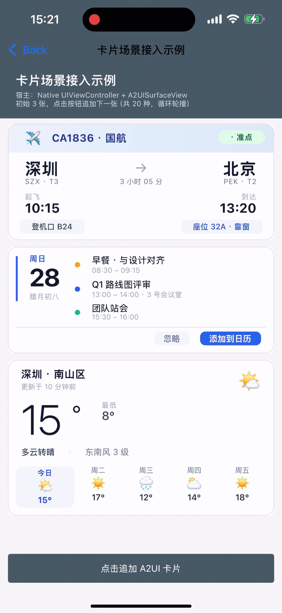
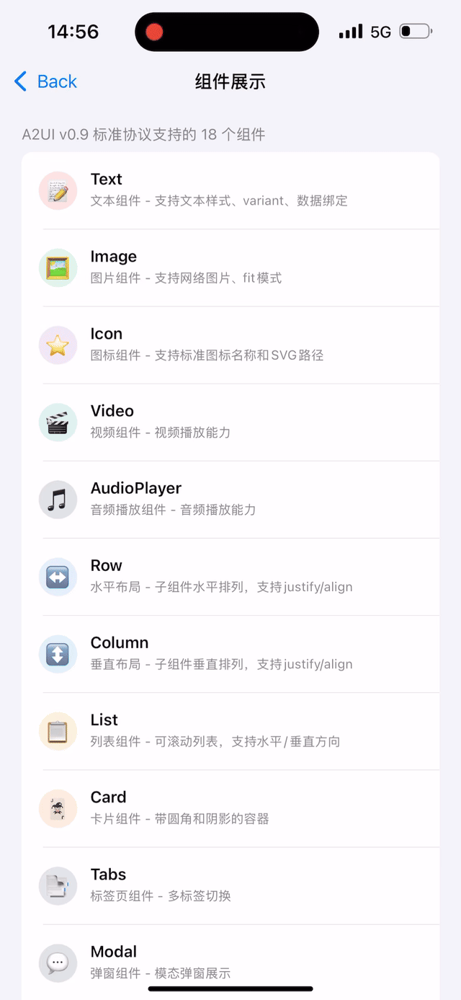

# Kuikly A2UI

Kuikly 对 [A2UI 协议](https://a2ui.org/) 的实现，支持 Android、iOS、HarmonyOS 原生渲染。

仓库：[Kuikly A2UI](https://github.com/Tencent-TDS/KuiklyUI-A2UI) · [English README](https://github.com/Tencent-TDS/KuiklyUI-A2UI/blob/main/README.md) · [官网](https://framework.tds.qq.com/)

## 项目介绍

随着 AI 大模型的广泛使用，应用侧各种聊天对话场景里展示的内容都由大模型生成。为了将大模型生成的静态文本替换为更图形化和可交互的 UI 界面，[A2UI 协议](https://a2ui.org/) 让服务端大模型生成一段结构化 JSON，动态描述 UI 卡片，然后客户端根据 JSON 描述的 UI 树结构来渲染卡片界面。

**Kuikly A2UI 使用 Kuikly 本身优秀并经过验证的渲染能力和性能，实现了 A2UI 协议在 Android、iOS、HarmonyOS 三端的原生渲染体验，并扩展了 UI 表现效果和自定义组件等方面的能力。**

Kuikly A2UI 核心 SDK 提供了从 JSON 流到渲染 UI 卡片的能力，以及操作 UI 卡片产生 Action 回调给业务的能力。业务接入后可连接服务端 AI 智能体、业务客户端和 Kuikly A2UI SDK 三者。服务端 AI 智能体生成 JSON 流给到业务客户端，进而给到 Kuikly A2UI SDK 渲染 UI 卡片；用户操作 UI 卡片，产生 Action 回调给业务客户端，业务客户端根据 Action 类型，判断出本地处理 Action，还是传给服务端 AI 智能体；服务端 AI 智能体收到 Action 可以进一步生成新的 JSON 流给客户端渲染新的 UI 卡片。

Kuikly A2UI 核心 SDK 内部直接对接 Kuikly DSL 组件树，将服务端下发的 JSON 协议转换为 Kuikly Core 管理的原生视图树，实现真正的“服务端驱动 UI”能力。内部整个流程即： 协议 → 内部消息 → DSL 操作 → 原生视图。

<div style="display: inline-block; text-align: center; margin-left: 20px;">
  
</div>

**Kuikly A2UI** 是 Kuikly A2UI 核心 SDK 的实现工程，旨在提供一套跨端、易用、灵活的面向用户和 AI 智能体交互的 UI 开发框架。目前已支持平台：

- [X] Android
- [X] iOS
- [X] HarmonyOS

> **名词约定**：本文中“**A2UI**”一律指 Google 开源的 [A2UI 协议](https://a2ui.org/)；“**Kuikly A2UI**”或“本工程”指当前仓库（即对 A2UI 协议的 Kuikly 实现）。

### 核心特性

- **服务端驱动**：UI 结构和样式完全由 JSON 消息流描述，无需客户端发版即可更新界面
- **原生渲染**：直接对接 Kuikly DSL 组件树，复用 Kuikly Core 的原生渲染引擎，性能与原生一致
- **流式解析**：支持 JSON 流式传输和增量解析，适配 AI 大模型流式输出场景
- **自动布局**：复用 Kuikly Core 内置的 FlexBox 布局引擎，无需额外布局计算逻辑
- **Action 机制**：完整的用户交互事件处理链路，支持服务端事件和本地函数调用
- **多种页面接入模式**：既能以原生 View（`A2UISurfaceView`）嵌入 Activity/UIViewController/ArkTS 页，也能以 DSL 组件（`A2UISurface { }`）嵌入 Kuikly Pager，同一 App 内可同时共存
- **自定义函数扩展**：客户端注册的业务函数可在 JSON 协议的属性绑定和 Action 中调用（[使用指南](https://github.com/Tencent-TDS/KuiklyUI-A2UI/blob/main/docs/A2UI_CUSTOM_FUNCTION_GUIDE.md)）
- **自定义组件扩展**：客户端注册的原生自定义组件（WebView、地图、图表 …）可在 JSON 协议中直接引用并参与 FlexBox 布局（[使用指南](https://github.com/Tencent-TDS/KuiklyUI-A2UI/blob/main/docs/A2UI_CUSTOM_COMPONENT_GUIDE.md)）
- **自定义 Icon 图片扩展**：客户端可用业务图片替换默认字符渲染，服务端 JSON 无需改动（[使用指南](https://github.com/Tencent-TDS/KuiklyUI-A2UI/blob/main/docs/A2UI_CUSTOM_ICON_GUIDE.md)）
- **内容自适应高度**：容器高度由内容布局自动决定（WRAP_CONTENT 模式）
- **跨平台**：基于 Kotlin Multiplatform，一套核心逻辑同时支持 Android、iOS、HarmonyOS

### 两类组件

一个 A2UI Surface 里可以**同时**使用两类组件，各取所长：

| 组件体系 | 用途 | 例子 |
|---|---|---|
| **A2UI 协议标准组件（含 Kuikly `styles` 扩展）** | AI 生成、跨平台标准协议 | `Text` / `Image` / `Button` / `Card` / `Column` / `Row` / `Tabs` / ... |
| **业务自定义组件** | WebView / 地图 / 图表等平台特有能力 | `A2UIWeb` / `A2UIChart` / `A2UIMap` |

标准组件用 A2UI v0.9 协议规范描述业务语义（`component` / `text` / `align` / `justify` / `action` 等），并通过可选的 `styles` 字段暴露 Kuikly 原生表现层能力。业务自定义组件用于承载平台原生能力，通过 Shadow 机制参与 FlexBox 布局，详见[自定义组件指南](https://github.com/Tencent-TDS/KuiklyUI-A2UI/blob/main/docs/A2UI_CUSTOM_COMPONENT_GUIDE.md)。

---

## 协议扩展：`styles` 字段

Kuikly A2UI 的协议 catalog 位于 [`catalogs/kuikly_a2ui_catalog.json`](https://github.com/Tencent-TDS/KuiklyUI-A2UI/blob/main/catalogs/kuikly_a2ui_catalog.json)。它以 `allOf` 方式复用 A2UI v0.9 官方 catalog 中每个组件的定义，然后追加一个**可选**的 `styles` 属性包。**不写 `styles` 时协议仍然是纯 v0.9**，多端行为一致，纯官方 v0.9 JSON 可以在 Kuikly A2UI 里直接运行；写了 `styles` 就获得 Kuikly 的完整原生表现层能力。

`styles` 分为两类：

| Schema 片段 | 适用组件 | 说明 |
|-------------|---------|------|
| `KuiklyCommonStyles` | 17 个组件（除 `Text`） | 尺寸/Flex/Margin/Padding/背景/边框/透明度/阴影/变换/绝对定位 |
| `KuiklyTextStyles` | 仅 `Text` | 在 `KuiklyCommonStyles` 之上追加字体/文本装饰/textShadow 等 13 个文本专属字段 |

> **说明**：与 A2UI 协议层字段（`id` / `action` / `accessibility` / `touchEnable`）有语义重叠的字段被有意排除在 `styles` 之外，避免歧义。

### `KuiklyCommonStyles` 典型字段

以下按功能分组给出典型字段清单。**完整定义**（含 `oneOf` 结构体形式、pattern、枚举、默认值）请以 [`catalogs/kuikly_a2ui_catalog.json`](https://github.com/Tencent-TDS/KuiklyUI-A2UI/blob/main/catalogs/kuikly_a2ui_catalog.json) 为准。

| 分组 | 典型字段 | 用途 |
|------|---------|------|
| **尺寸** | `width` / `height` / `minWidth` / `minHeight` / `maxWidth` / `maxHeight` | 显式尺寸约束（dp/pt） |
| **Flex** | `flex` / `flexGrow` / `flexShrink` / `flexBasis` / `alignSelf` | 参与父级 Flex 分配（`alignSelf: auto\|flex-start\|flex-end\|center\|stretch\|baseline`） |
| **Margin** | `margin` / `marginTop` / `marginBottom` / `marginLeft` / `marginRight` | 外边距 |
| **Padding** | `padding` / `paddingTop` / `paddingBottom` / `paddingLeft` / `paddingRight` | 内边距 |
| **背景与渐变** | `backgroundColor` / `backgroundLinearGradient` | 纯色（CSS hex）或结构化线性渐变（`direction` + `colorStops[]`） |
| **边框** | `borderWidth` / `borderColor` / `borderStyle` / `borderRadius` | 边框粗细/颜色/线型（`solid\|dotted\|dashed`）+ 圆角 |
| **不透明与可见性** | `opacity` / `visibility` / `overflow` / `zIndex` | 全屏叠加/裁剪场景常用 |
| **阴影** | `boxShadow` | 结构化：`offsetX` / `offsetY` / `radius` / `color` / `fill`（`fill:true` = 内阴影） |
| **变换** | `transform` | 结构化：`rotate` / `scale` / `translate` / `anchor` / `skew` / `rotateXY`，其中 translate 是相对自身 frame 的比例 |
| **绝对定位** | `positionType` / `top` / `left` / `bottom` / `right` | `positionType: absolute` 时相对最近的定位祖先偏移 |

### `KuiklyTextStyles` 专属字段（仅 Text）

| 分组 | 典型字段 | 说明 |
|------|---------|------|
| **字体** | `fontSize` / `color` / `fontWeight` / `fontStyle` / `fontFamily` | `fontWeight` 支持 `normal\|light\|medium\|semibold\|bold` 或 300-900 |
| **对齐** | `textAlign` | `left\|center\|right` |
| **装饰** | `textDecoration` | `none\|underline\|line-through` |
| **行距/字距** | `lineHeight` / `lineSpacing` / `letterSpacing` / `firstLineHeadIndent` | 精细排版 |
| **多行** | `numberOfLines` | 最大行数（超过省略号） |
| **文字阴影** | `textShadow` | `{ offsetX, offsetY, radius, color }` |

### 示例：一段用了 `styles` 的天气卡片

```json
{
  "version": "v0.9",
  "updateComponents": {
    "surfaceId": "weather-card",
    "components": [
      {
        "id": "root", "component": "Card", "child": "outer",
        "styles": {
          "padding": 10,
          "backgroundLinearGradient": {
            "direction": "to-bottom",
            "colorStops": [
              { "color": "#3A6DF0", "stop": 0.0 },
              { "color": "#7A3FD8", "stop": 1.0 }
            ]
          }
        }
      },
      { "id": "outer", "component": "Column", "align": "stretch", "children": ["title", "temp"] },
      {
        "id": "title", "component": "Text", "text": "深圳 · 今日天气",
        "styles": {
          "color": "#FFFFFF", "fontSize": 15, "fontWeight": "medium",
          "letterSpacing": 1, "textAlign": "center"
        }
      },
      {
        "id": "temp", "component": "Text", "text": "27°",
        "styles": {
          "color": "#FFFFFF", "fontSize": 84, "fontWeight": "light",
          "textShadow": { "offsetX": 0, "offsetY": 2, "radius": 12, "color": "#66000000" }
        }
      }
    ]
  }
}
```

---

## 目录结构

```
Kuikly A2UI/                             # 工程根目录（本仓库）
├── a2ui/                                  # 核心跨平台模块 (Kotlin Multiplatform)
│   └── src/commonMain/kotlin/com/tencent/kuikly/a2ui/
│       ├── adapter/                       # 协议适配器
│       │   ├── A2UIProtocolAdapter.kt        # 核心协议适配（数据绑定、组件映射）
│       │   └── A2UIComponentMapper.kt        # A2UI v0.9 组件 + Kuikly styles 映射
│       ├── bridge/                        # Native ↔ Kotlin 桥接
│       ├── dsl/                           # Kuikly DSL 对接层（核心）
│       │   ├── A2UIPager.kt                  # Kuikly Pager 容器（内容自适应高度）
│       │   ├── A2UIDSLBridge.kt              # DSL 桥接
│       │   ├── A2UIApplier.kt                # 组件树操作
│       │   └── embed/
│       │       ├── A2UISurface.kt            # DSL 组件（用于 Kuikly 页面嵌入）
│       │       └── A2UISurfaceDSLView.kt     # DSL 组件对应的 View
│       ├── parser/                        # JSON 流式解析器
│       └── protocol/                      # 协议数据模型
│
├── a2ui-render-android/                   # Android 渲染模块（A2UISurfaceView）
├── a2ui-render-ios/                       # iOS 渲染模块（A2UISurfaceView）
├── a2ui-render-ohos/                      # HarmonyOS 渲染模块（A2UISurfaceView）
│
├── catalogs/                              # 协议 catalog
│   └── kuikly_a2ui_catalog.json           # v0.9 + Kuikly styles 扩展的完整 schema
│
├── demo/                                  # 业务 KMP 示例模块（@Page 页面样例）
│
├── androidAppForNativePage/               # Android Native 页接入示例
├── androidAppForKuiklyPage/               # Android Kuikly 页接入示例
├── androidAppForBothPages/                # Android 两种页面同时接入示例
├── androidAppForTest/                     # Android 协议 & 功能测试 App
├── iosAppForNativePage/                   # iOS Native 页接入示例
├── iosAppForKuiklyPage/                   # iOS Kuikly 页接入示例
├── iosAppForBothPages/                    # iOS 两种页面同时接入示例
├── iosAppForTest/                         # iOS 协议 & 功能测试 App
├── ohosAppForNativePage/                  # HarmonyOS Native 页接入示例
├── ohosAppForKuiklyPage/                  # HarmonyOS Kuikly 页接入示例
├── ohosAppForBothPages/                   # HarmonyOS 两种页面同时接入示例
├── ohosAppForTest/                        # HarmonyOS 协议 & 功能测试 App
│
├── buildSrc/                              # Gradle plugin & 常量（版本号等）
├── scripts/                               # 工程脚手架脚本（含 link-kuikly.sh）
├── publish/                               # 发版脚本、兼容性 patch 配置
├── gradle.properties                      # kuikly.projectDir 等工程全局配置
├── local.properties.example               # 每台机器可覆盖的本地配置模板
├── settings.gradle.kts                    # 2.1.21 主线 settings
├── settings.2.0.ohos.gradle.kts           # HarmonyOS 2.0 兼容 settings
├── build.2.1.21.gradle.kts / build.2.0.ohos.gradle.kts   # 双 buildfile
└── 2.0_a2ui_ohos_build{,_release}.sh      # HarmonyOS 构建脚本
```

> **依赖模式**：默认走本地源码依赖（`kuikly.projectDir` 指向外部 KuiklyUI 仓库，缺省 `../KuiklyUI`），也可切换为 Maven 产物依赖。详见 [`SETUP-zh_CN.md`](https://github.com/Tencent-TDS/KuiklyUI-A2UI/blob/main/SETUP-zh_CN.md)。

---

## 架构概览

A2UI 采用 **直接对接 Kuikly DSL 组件树** 的架构，JSON 协议经过解析和适配后，直接操作 Kuikly Core 的组件树，由 Kuikly Core 统一负责布局计算和原生渲染：

```
┌─────────────────────────────────────────────────────────┐
│                    Server / AI Model                      │
│              (生成 JSON 消息流)                            │
└────────────────────────┬────────────────────────────────┘
                         │ JSON Stream
                         ▼
┌─────────────────────────────────────────────────────────┐
│              A2UI Core (Kotlin Multiplatform)             │
│                                                          │
│  ┌──────────────┐  ┌──────────────┐  ┌──────────────┐  │
│  │ StreamParser  │→ │  DSLBridge   │→ │ProtocolAdapter│  │
│  │ (流式解析)    │  │ (消息路由)    │  │(协议适配/映射) │  │
│  └──────────────┘  └──────────────┘  └──────────────┘  │
│                              │                           │
│                              ▼                           │
│  ┌──────────────────────────────────────────────────┐   │
│  │              A2UIApplier (组件树操作)               │   │
│  │  createComponent / updateComponent / removeComponent │ │
│  └──────────────────────────┬───────────────────────┘   │
│                              │                           │
│                              ▼                           │
│  ┌──────────────────────────────────────────────────┐   │
│  │  A2UIPager  或  嵌入宿主 Kuikly Pager 的 Flex 树     │   │
│  │  ┌─────────────────────────────────────────────┐ │   │
│  │  │     Kuikly DSL Component Tree               │ │   │
│  │  └─────────────────────────────────────────────┘ │   │
│  └──────────────────────────┬───────────────────────┘   │
│                              │                           │
│  ┌──────────────────────────────────────────────────┐   │
│  │           Kuikly Core (自动布局 + 渲染)             │   │
│  │  • FlexNode 布局计算   • RenderView 创建             │   │
│  │  • 文本测量           • 组件生命周期管理              │   │
│  └──────────────────────────┬───────────────────────┘   │
└─────────────────────────────┼───────────────────────────┘
                              │ NativeBridge
                              ▼
┌─────────────────────────────────────────────────────────┐
│            Platform Render Layer (原生渲染层)              │
│                                                          │
│  Android: A2UISurfaceView / A2UISurface { }             │
│  iOS:     A2UISurfaceView / A2UISurface { }             │
│  HarmonyOS: A2UISurfaceView / A2UISurface { }           │
└─────────────────────────────────────────────────────────┘
```

### 核心设计决策

| 设计点 | 说明 |
|--------|------|
| **布局计算** | 完全由 Kuikly Core 的 FlexNode 引擎处理，A2UI 不做任何手动布局 |
| **文本测量** | 复用 RichTextView 内置的 TextShadow，无需手动 MeasureFunction |
| **容器高度** | 内容驱动（WRAP_CONTENT），宽度由外部约束，高度由 Flex 引擎回报 |
| **渲染管线** | 通过 Kuikly Core 标准 NativeBridge 发送渲染指令，与 Kuikly DSL 页面共享同一套渲染层 |
| **数据绑定** | 由 A2UIProtocolAdapter 内置处理 path 引用和 function call 绑定 |
| **协议扩展** | `styles` 字段通过 catalog `allOf` 追加，标准 v0.9 JSON 无需改动即可运行 |

---

## 三种页面接入模式

A2UI 支持三种页面接入模式，每种模式有独立的接入文档：

| 接入模式 | 宿主形态 | 何时选 | 文档 |
|---------|---------|--------|------|
| **Native 页面接入** | 原生 `Activity` / `UIViewController` / ArkTS `@Entry` | 宿主是纯原生页 | [A2UI_INTEGRATION_NATIVE_PAGE.md](https://github.com/Tencent-TDS/KuiklyUI-A2UI/blob/main/docs/A2UI_INTEGRATION_NATIVE_PAGE.md) |
| **Kuikly 页面接入** | Kuikly Pager（`@Page` 注解 + DSL）| 宿主页本身是 Kuikly DSL 页，希望在 DSL 里嵌入 A2UI 子树，共享一颗 Flex 布局树 | [A2UI_INTEGRATION_KUIKLY_PAGE.md](https://github.com/Tencent-TDS/KuiklyUI-A2UI/blob/main/docs/A2UI_INTEGRATION_KUIKLY_PAGE.md) |
| **同一 App 同时接入两种页面** | 一部分是原生页、一部分是 Kuikly 页 | 增量迁移、混合 UI 栈 | [A2UI_INTEGRATION_BOTH_PAGES.md](https://github.com/Tencent-TDS/KuiklyUI-A2UI/blob/main/docs/A2UI_INTEGRATION_BOTH_PAGES.md) |

### 最小 Hello World

**Native 页接入**（Android 示例）：

```kotlin
val surface = A2UISurfaceView(this)
surface.init("{}")
surface.setListener(myListener)

surface.writeStream("""{"version":"v0.9","createSurface":{"surfaceId":"hi"}}""")
surface.writeStream("""{"version":"v0.9","updateComponents":{"surfaceId":"hi","components":[
    {"id":"root","component":"Text","text":"Hello A2UI!",
     "styles":{"fontSize":20,"color":"#333333"}}
]}}""")
surface.finishStream()
```

**Kuikly 页接入**（Kotlin DSL 示例）：

```kotlin
@Page("MyKuiklyPage")
class MyKuiklyPage : Pager() {
    private var surface: A2UISurfaceDSLView? = null
    override fun body() = ViewBuilder {
        A2UISurface {
            surface = this
            attr { flex(1f) }
            event { action { _, _, actionJson -> /* … */ } }
        }
    }
    fun onChunk(chunk: String) { surface?.writeStream(chunk) }
    fun onDone() { surface?.finishStream() }
}
```

iOS / HarmonyOS 的 API 语义与 Android **完全一致**（`initSurface` / `writeStream` / `finishStream`）。详细步骤见对应接入文档。

---

## 接入文档

### 接入指南

| 文档 | 说明 |
|------|------|
| [Native 页面接入指南](https://github.com/Tencent-TDS/KuiklyUI-A2UI/blob/main/docs/A2UI_INTEGRATION_NATIVE_PAGE.md) | 宿主是原生 `Activity`/`UIViewController`/ArkTS 页时的接入流程（三端） |
| [Kuikly 页面接入指南](https://github.com/Tencent-TDS/KuiklyUI-A2UI/blob/main/docs/A2UI_INTEGRATION_KUIKLY_PAGE.md) | 宿主是 Kuikly Pager（DSL 页）时的接入流程（三端） |
| [两种页面同时接入指南](https://github.com/Tencent-TDS/KuiklyUI-A2UI/blob/main/docs/A2UI_INTEGRATION_BOTH_PAGES.md) | 一个 App 内两种页面共存时的依赖合并与平台陷阱 |

### 自定义扩展

| 文档 | 说明 |
|------|------|
| [自定义函数使用指南](https://github.com/Tencent-TDS/KuiklyUI-A2UI/blob/main/docs/A2UI_CUSTOM_FUNCTION_GUIDE.md) | 自定义函数的 JSON 协议格式、三端注册 API、完整示例 |
| [自定义组件使用指南](https://github.com/Tencent-TDS/KuiklyUI-A2UI/blob/main/docs/A2UI_CUSTOM_COMPONENT_GUIDE.md) | 自定义组件的原理、Shadow 测量、三端注册 API、Demo 参考 |
| [自定义 Icon 图片使用指南](https://github.com/Tencent-TDS/KuiklyUI-A2UI/blob/main/docs/A2UI_CUSTOM_ICON_GUIDE.md) | Icon 图片资源约定、三端注册 API、Fallback 策略 |

### 底层实现

| 文档 | 说明 |
|------|------|
| [实现设计文档](https://github.com/Tencent-TDS/KuiklyUI-A2UI/blob/main/docs/A2UI_KUIKLY_IMPLEMENTATION_DESIGN.md) | A2UI 核心架构、实现细节、扩展指引 |
| [协议 Catalog（Schema）](https://github.com/Tencent-TDS/KuiklyUI-A2UI/blob/main/catalogs/kuikly_a2ui_catalog.json) | v0.9 + Kuikly `styles` 扩展的完整 JSON Schema |

---

## Demo 体验

### 运行效果

Android / iOS / HarmonyOS 三端 Demo 已内置：

- **卡片接入示例**：加载 JSON 字符串生成 A2UI 卡片，以及通过点击添加按钮模拟卡片动态生成的过程。有机票状态卡片、日程安排卡片、天气卡片、商品卡片等。

<div style="display: inline-block; text-align: center; margin-left: 30px;">
  
</div>

- **组件展示**：按照 A2UI 协议 v0.9 定义，18 个标准组件全覆盖（Text / Image / Button / Card / Column / Row / List / Tabs / Slider / CheckBox / ChoicePicker / DateTimeInput / TextField / Video / AudioPlayer / Modal / Divider / Icon）

<div style="display: inline-block; text-align: center; margin-left: 30px;">
  
</div>

- **自定义组件示例**：展示了自定义 Web 组件和自定义简单 View 组件的示例。
- **自定义函数示例**：展示了 A2UI JSON 串里调用自定义函数的多个示例。
- **自定义 Icon 图片示例**：展示了 App 如果使用自定义 Icon 图片替换所有 Icon 组件默认图标的示例。

### 快速体验

<div style="display: inline-block; text-align: center; margin-left: 30px;">
  
</div>

安卓手机扫码快速体验。iPhone和鸿蒙手机请按下面步骤源码编译 Demo APP 体验。

### 源码编译

仓库中提供了 3 × 4 = 12 个示例工程，覆盖 3 端（Android / iOS / HarmonyOS）× 4 种（Native 页接入 / Kuikly 页接入 / 两种同时接入 / 协议测试）。

**先决条件**：本工程依赖外部 KuiklyUI Core 仓库，默认配置位置为 `../KuiklyUI`，所以最简单的源码依赖方式是：直接 clone [KuiklyUI](https://github.com/Tencent-TDS/KuiklyUI) main 分支代码到和 Kuikly A2UI 并列的目录。详细配置依赖可阅读 [`SETUP-zh_CN.md`](https://github.com/Tencent-TDS/KuiklyUI-A2UI/blob/main/SETUP-zh_CN.md)，按需修改 `gradle.properties` 中的 `kuikly.projectDir`（或在 `local.properties` 里覆盖）。

然后按平台运行任意 demo：

```bash
# Android：任选一个示例工程
./gradlew :androidAppForNativePage:installDebug
./gradlew :androidAppForKuiklyPage:installDebug
./gradlew :androidAppForBothPages:installDebug
./gradlew :androidAppForTest:installDebug

# iOS：任选一个示例工程
cd iosAppForNativePage && bash setup.sh && open A2UIDemoApp.xcworkspace
cd iosAppForKuiklyPage && bash setup.sh && open A2UIDemoApp.xcworkspace
cd iosAppForBothPages  && bash setup.sh && open A2UIDemoApp.xcworkspace
cd iosAppForTest       && bash setup.sh && open A2UIDemoApp.xcworkspace

# HarmonyOS：先在【本工程根目录】执行构建脚本，产出 libshared.so 到各 ohosAppFor* 模块
./2.0_a2ui_ohos_build.sh          # Debug 构建
./2.0_a2ui_ohos_build_release.sh  # Release 构建
# 然后用 DevEco Studio 打开对应目录并运行：
# ohosAppForNativePage / ohosAppForKuiklyPage / ohosAppForBothPages / ohosAppForTest
```

---

## 核心模块说明

### A2UIBridgeManager（入口管理器）

Kotlin Common 层的统一入口，管理所有 A2UI 实例的生命周期：

| 方法 | 说明 |
|------|------|
| `callKotlinMethod(INIT, ...)` | 创建实例，初始化 DSL 桥接和 Pager |
| `callKotlinMethod(WRITE_STREAM, ...)` | 写入 JSON 消息流 |
| `callKotlinMethod(FINISH_STREAM, ...)` | 标记流结束，触发最终布局 |
| `callKotlinMethod(SET_SURFACE_SIZE, ...)` | 设置容器宽高约束 |
| `callKotlinMethod(VIEW_CLICK, ...)` | 处理用户点击事件 |
| `callKotlinMethod(DESTROY, ...)` | 销毁实例，释放资源 |

### A2UIDSLBridge（DSL 桥接层）

连接 StreamParser 和 Applier，负责：

- 创建和管理 A2UIPager（Kuikly Pager 容器）
- 将解析出的 JSON 消息路由到 A2UIApplier
- 管理 A2UIProtocolAdapter（协议适配）
- 处理内容高度变化回报

### A2UIApplier（组件树操作）

将 JSON 协议操作翻译为 Kuikly DSL 组件树操作：

- `createComponent()` — 创建 DSL 组件并插入树
- `updateComponent()` — 更新组件属性（通过 `attr {}` DSL）
- `removeComponent()` — 从树中移除组件
- `performLayout()` — 触发布局计算并回报内容高度

### A2UIPager（Kuikly Pager 容器）

继承 Kuikly `Pager`，作为 A2UI 组件树的根容器：

- 宽度由外部容器约束（`setSurfaceWidth()`）
- 高度由内容自动决定（`flexNode.styleHeight = Float.NaN`）
- 布局完成后通过 `onContentHeightChanged` 回报实际内容高度
- 维护 tag → view 映射表，支持按 tag 查找组件

### A2UIProtocolAdapter（协议适配器）

处理 A2UI v0.9 + Kuikly `styles` 扩展协议：

- **数据绑定**：解析 `{"path": "/xxx"}` 引用，在 `updateDataModel` 时重新评估
- **组件映射**：将 v0.9 标准组件（Text/Image/Button …）映射为 Kuikly 组件
- **`styles` 应用**：将 `KuiklyCommonStyles` / `KuiklyTextStyles` 转换为 Kuikly 原生属性
- **Action 注册**：收集组件的 action 属性，建立 tag → action 映射

---

## 线程模型

| 线程 | 职责 |
|------|------|
| **Main Thread** | UI 渲染、View 创建/更新、用户交互事件 |
| **Context Queue** | Kotlin 逻辑执行、JSON 解析、DSL 组件树操作、布局计算 |

- `writeStream` / `finishStream` 将任务调度到 Context Queue
- Kuikly Core 在 Context Queue 完成布局计算后，通过 `FLUSH_UI_TASKS` 批量提交渲染指令到 Main Thread
- 用户点击等交互事件在 Main Thread 触发，通过桥接回调到 Context Queue 处理
- 所有 DSL 组件树操作（`attr {}`、`addChild`）必须在 Context Queue 执行

---

## 版本信息

- **语义版本**：`0.9.0-SNAPSHOT`（用于 iOS pod、HarmonyOS ohpm、README 显示）
- **Android/KMP Maven 坐标**：`0.9.0-2.1.21-SNAPSHOT`（默认，Kotlin `2.1.21`），HarmonyOS 兼容构建为 `0.9.0-2.0.21-ohos-SNAPSHOT`。这是为对齐 KuiklyUI Core 的坐标规则；两种版本号都由 [`buildSrc/src/main/java/A2uiVersion.kt`](https://github.com/Tencent-TDS/KuiklyUI-A2UI/blob/main/buildSrc/src/main/java/A2uiVersion.kt) 生成
- **依赖 KuiklyUI Core 版本**：2.1.21 主线（HarmonyOS 2.0 兼容构建使用 2.0.21-KBA-010，见 `settings.2.0.ohos.gradle.kts`）
- **最低 Android SDK**：API 21 (Android 5.0)
- **最低 iOS 版本**：14.0
- **HarmonyOS**：API 12 及以上（DevEco Studio 4.1+）
- **Kotlin 版本**：2.1.21
- **Gradle 版本**：7.6.3（HarmonyOS 2.0 兼容构建下切至 8.0，由 `publish/FileReplacer` 临时打补丁）
- **JDK 要求**：17+

> 依赖策略与版本覆盖方式详见 [`SETUP-zh_CN.md`](https://github.com/Tencent-TDS/KuiklyUI-A2UI/blob/main/SETUP-zh_CN.md)。

---

## License

Kuikly A2UI License. See [LICENSE](https://github.com/Tencent-TDS/KuiklyUI-A2UI/blob/main/LICENSE) for details.

本工程 demo 中的部分示例 JSON 资源派生自 Google LLC 的 A2UI 项目（Apache License 2.0），相关归属与文件清单见 [THIRD_PARTY_LICENSES](https://github.com/Tencent-TDS/KuiklyUI-A2UI/blob/main/THIRD_PARTY_LICENSES)。
