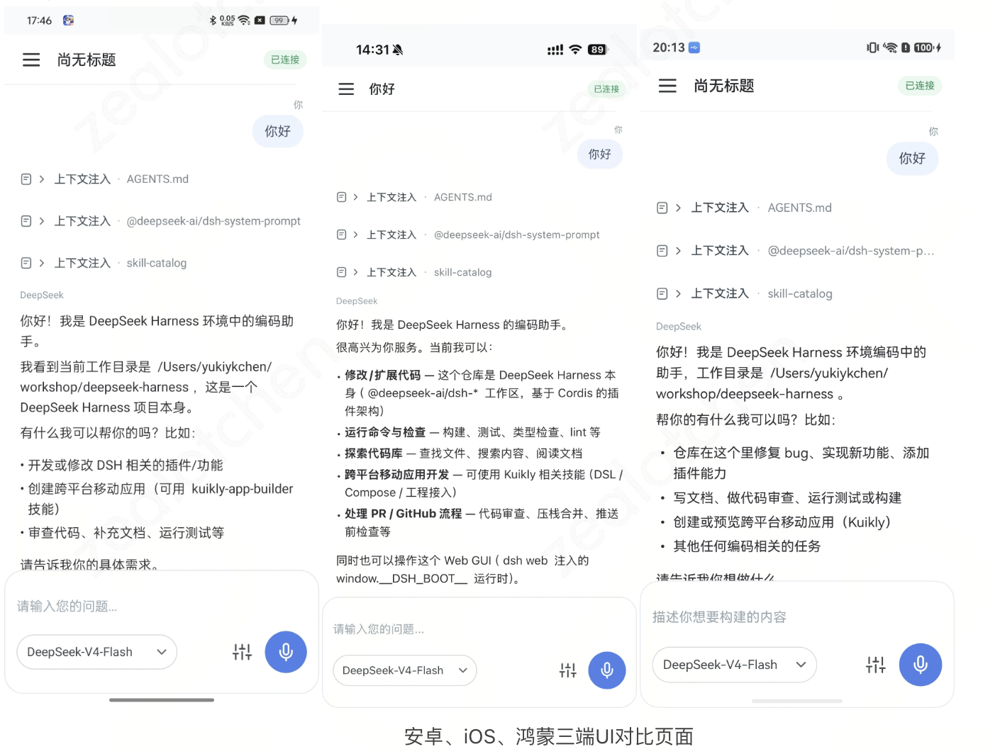

# Kuikly AIChat 套件

在移动 App 中集成 AI 对话体验时，团队常需耗费数周时间自行开发气泡列表、流式渲染状态机、Markdown 解析器及 Agent 交互卡片。

Kuikly 生态开源了 **KuiklyChatUI** 与 **KuiklyMarkdown** 核心组件，并结合真实落地的开源项目 **DeepSeek Harness Mobile**，为开发者提供开箱即用的一站式 AI 交互解决方案。同一套对话界面在 Android、iOS、鸿蒙上保持一致。



---

## 一、KuiklyChatUI：开箱即用的跨端聊天组件库

> **开源仓库**：[https://github.com/Kuikly-contrib/KuiklyChatUI](https://github.com/Kuikly-contrib/KuiklyChatUI)

KuiklyChatUI 是一套基于 Kuikly 构建的高性能跨平台会话 UI 组件库，完美适配 Android、iOS 及纯血鸿蒙（HarmonyOS NEXT）。

### 1. 模块化设计

KuiklyChatUI 采用细粒度分模块设计，开发者可按需引入，避免引入冗余依赖：

| 子模块坐标 | 职责定位 |
| :--- | :--- |
| **`com.tencent.kuiklybase:kuiklychat-compose`** | **Compose DSL 入口**：提供标准的 `ChatScreen` 组件。 |
| **`com.tencent.kuiklybase:kuiklychat-compat`** | **Kuikly DSL 入口**：提供面向传统 DSL 的 `ChatControllerSession`。 |
| **`com.tencent.kuiklybase:kuiklychat-agui`** | **AG-UI 协议层**：负责 AG-UI 事件流解析、SSE 转换与消息状态管理。 |
| **`com.tencent.kuiklybase:kuiklychat-agentcard`** | **Agent 专属卡片**：支持思考折叠（Thinking）、代码块、命令执行、工具调用（Tool Call）、表格与图表展示。 |
| **`com.tencent.kuiklybase:kuiklychat-ai`** | **Kuikly AI 专属桥接**：提供模型对话流与上下文会话封装。 |

### 2. Maven 仓库配置

**标准平台（Android / iOS / macOS）**：
```kotlin
// settings.gradle.kts
dependencyResolutionManagement {
    repositories {
        google()
        mavenCentral()
        maven { url = uri("https://mirrors.tencent.com/repository/maven/kuikly") }
        maven { url = uri("https://mirrors.tencent.com/repository/maven/tencent_public") }
    }
}
```

**鸿蒙平台（HarmonyOS）**：
```kotlin
// settings.ohos.gradle.kts
dependencyResolutionManagement {
    repositories {
        google()
        mavenCentral()
        maven { url = uri("https://mirrors.tencent.com/repository/maven/tencentvideo") }
        maven { url = uri("https://mirrors.tencent.com/repository/maven/tmm-snapshot") }
        maven { url = uri("https://mirrors.tencent.com/repository/maven/kuikly") }
    }
}
```

### 3. 核心接入示例

无论使用 Kuikly DSL 还是 Compose DSL，均通过统一的 `ChatController` 驱动数据流：

```kotlin
// 1. 初始化会话控制器与发送器
val controller = ChatController(
    currentUser = ChatUser(id = "user_me", name = "用户"),
    scope = coroutineScope,
    sender = ChatMessageSender { message ->
        flow {
            // 模拟流式打字机输出
            emit(ChatStreamEvent.TextDelta("正在为您查询：${message.text}..."))
            emit(ChatStreamEvent.TextDelta("\n查询已完成！"))
            emit(ChatStreamEvent.Completed)
        }
    }
)

// 2. 界面挂载（Compose DSL）
@Composable
fun MyAIChatPage() {
    ChatScreen(controller = controller)
}

// 3. 或在 Kuikly DSL 中使用
ChatControllerSession(
    controller = controller,
    composerBottomInset = pagerData.safeAreaInsets.bottom
)
```

---

## 二、KuiklyMarkdown：高性能流式渲染组件

> **开源仓库**：[https://github.com/Kuikly-contrib/KuiklyMarkdown](https://github.com/Kuikly-contrib/KuiklyMarkdown)

传统的移动端 Markdown 组件（如基于 Webview 或静态富文本控件）在应对大模型**高频 Token 流式吐字**时，极易因高频布局重排（Layout Thrashing）产生页面闪烁与帧率骤降。KuiklyMarkdown 专为此场景进行了底层架构重构。

```
大模型流式输出 (SSE Tokens)
            │
            ▼
┌──────────────────────────────────────────────┐
│  KuiklyMarkdown 增量 AST 状态机              │
│  - 仅重新解析尾部变动节点，避免全局重新构建    │
├──────────────────────────────────────────────┤
│  内置 Highlights 高亮引擎 (支持 19 种语言)   │
├──────────────────────────────────────────────┤
│  节点映射：21 种可自定义的原生 View 节点     │
│  (标题 / 列表 / 引用 / 代码块 / 表格 / ...)  │
└──────────────────────────────────────────────┘
            │
            ▼
 原生组件树直接更新 (平滑滚动，无卡顿无白屏)
```

### 核心特性

1. **完整的 GFM 语法覆盖**：全量支持标题、无序/有序列表、任务清单、引用、多级嵌套、GFM 表格、脚注与图片。
2. **专业代码高亮引擎**：内置 Highlights 引擎，原生支持 Kotlin、Java、Swift、JavaScript、TypeScript、Python、Go、Rust、C++ 等 **19 种常见语言的语法高亮**。
3. **21 种块级节点完全可替换**：提供插槽机制，允许业务针对表格、代码块或超链接替换为定制的原生卡片控件。
4. **低延迟增量解析**：在大模型打字机输出过程中保持 60fps/120fps 满帧滚动，大幅削减 CPU 占用与内存峰值。

### 接入方式

```kotlin
// build.gradle.kts
dependencies {
    implementation("com.tencent.kuiklybase:KuiklyMarkdown:1.0.6-2.1.21")
}
```

```kotlin
// 在页面中渲染流式 Markdown
MarkdownView {
    attr {
        content(streamingMarkdownText)
        theme(MarkdownTheme.Auto) // 支持深浅色模式自动适配
    }
}
```

---

## 三、生产级项目实战：DeepSeek Harness Mobile

> **开源仓库**：[https://github.com/yukiykchen/deepseek-harness-mobile](https://github.com/yukiykchen/deepseek-harness-mobile)

**DeepSeek Harness Mobile** 是社区开源的实验性移动宿主项目，致力于将功能强大的 DeepSeek Harness Agent 完整接入 Android 与 iOS 手机，让开发者随时随地操控 Agent 完成复杂的编码与工程任务。

```
 ┌──────────────────────┐                     ┌────────────────────────┐
 │ 移动端 (Kuikly 宿主) │                     │   开发者电脑 / 服务器  │
 │                      │  Relay 加密隧道     │                        │
 │ • KuiklyChat 会话    │ ◄─────────────────► │  DeepSeek Harness Host │
 │ • KuiklyMarkdown 渲染│  或 SSH 端口转发    │  • Agent 核心运行时    │
 │ • 本地安全会话缓存   │                     │  • 本地代码与终端操作  │
 └──────────────────────┘                     └────────────────────────┘
```

### 为什么选择 Kuikly 打造 AI 移动宿主？

1. **轻量增量体积，秒级启动**：
   Kuikly 生成的产物为纯原生包（Android `.aar` AOT 增量仅约 300KB，iOS 约 1.2MB）。极小的包体积使得 App 首屏毫秒级秒开，交互无延迟。
2. **多连接模式与可靠状态隔离**：
   项目利用 Kotlin Multiplatform 统一实现了两套远程连接通道与一套本地离线通道：
   * **扫码连接（Remote Relay）**：手机扫描电脑端二维码，通过安全 Relay 隧道与本机 Loopback WebSocket（`events.mux`）双向通信。
   * **SSH 隧道连接**：通过本地端口转发直连服务器环境。
   * **多模式会话隔离**：按连接来源（`relay:<hostId>`、`ssh:default`）严密隔离消息缓存与环境上下文。
3. **沉浸式 AI 对话流体验**：
   页面层全面采用 `KuiklyChatUI` 与 `KuiklyMarkdown`，无论是模型深度思考过程的折叠展示、长篇代码块的语法高亮，还是复杂多步骤工具调用（Tool Calls），均获得丝滑的原生渲染体验。

---

## 总结

通过 **KuiklyChatUI**、**KuiklyMarkdown** 以及 **DeepSeek Harness Mobile**，Kuikly 生态为移动端开发者提供了一条从基础组件、富文本渲染到端侧完整架构的清晰落地路径。无论你是需要为已有 App 添加一个小型的 AI 问答抽屉，还是构建一个全功能的 AI 智能体客户端，都可以直接复用这些成熟资产。
