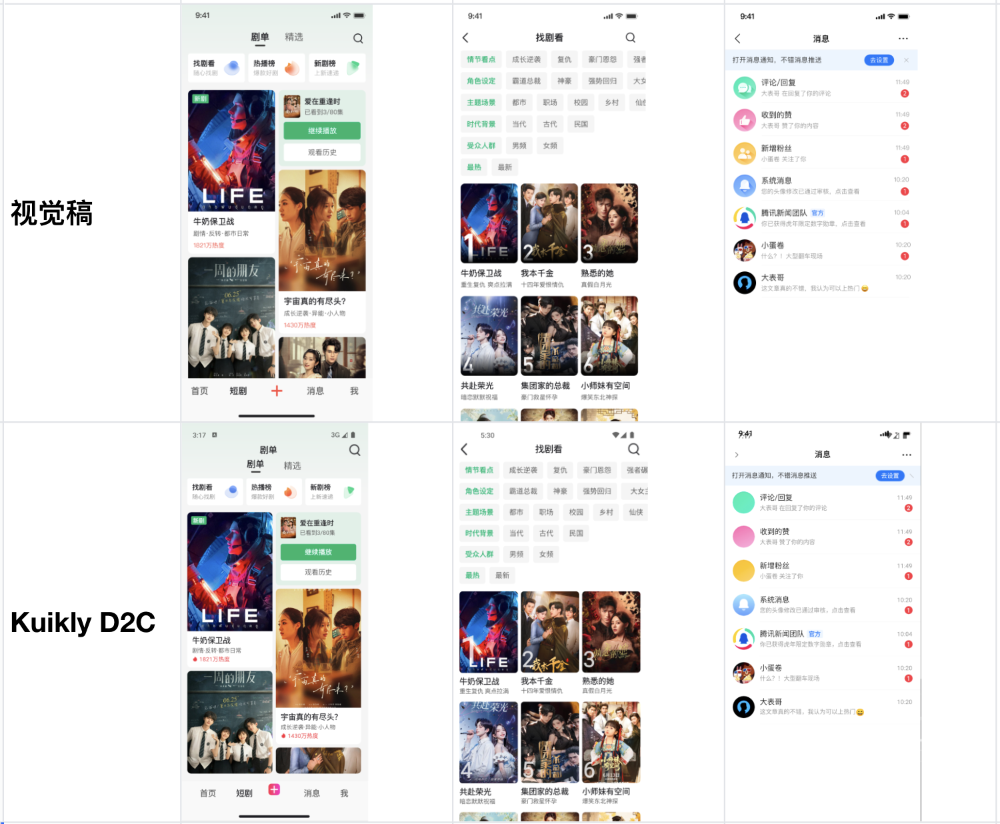

# D2C 设计稿转代码

视觉稿转码把 Figma 设计稿转成 Kuikly 页面代码，保留布局和样式，并同步图片资源。页面骨架和切图不再手写，开发继续处理交互、数据和业务状态。

## 它解决什么问题

对照设计稿还原界面时，时间大多花在量边距、对字号、导图片、改层级上。设计一改，这套工作还要再做一遍。D2C 把这一段变成一次转换：输入设计稿节点，输出可放进 Kuikly 工程的页面代码和资源。

## 转换原理

```
Figma 设计稿
    │  读取图层树、Auto Layout、样式和图片
    ▼
Deco 转码
    │  布局映射为 Kuikly 弹性布局
    │  样式写入组件属性
    │  能对上的图层复用工程里已有组件
    ▼
Kuikly 页面代码 + 图片资源
    │  Kuikly DSL 或 Kuikly Compose DSL
    ▼
Android / iOS / 鸿蒙 预览
```

转换分四步。

1. **读取设计稿结构**  
   以选中的 Frame 或组件为入口，读取图层树、约束、Auto Layout、字体、颜色、圆角、阴影、渐变和图片。绝对定位和自动布局会分开处理，避免把画板坐标原样抄成一堆写死的宽高。

2. **映射到 Kuikly 布局和样式**  
   Auto Layout 的主轴、交叉轴、间距和内边距，对应到 Kuikly 的弹性布局。文本、背景、边框、圆角、阴影保留为组件属性。过深、无实际意义的编组会收掉，避免生成过深的视图层级。

3. **优先复用已有组件**  
   转码前可以扫描当前工程里的 Kuikly 组件。按钮、头像、价格、列表项这类已经封装过的控件，会按图层特征匹配到现有实现，而不是再生成一份基础 View。业务组件库因此会进入生成结果，页面风格和工程里手写的代码更接近。

4. **导出资源并写回工程**  
   图标和图片按倍率导出，写入页面资源目录或同步到资源服务，代码里使用 Kuikly 的资源引用。Android Studio 插件和命令行都可以完成这一步。生成结果可以选择 Kuikly DSL 或 Kuikly Compose DSL。

## 还原效果

同一套剧集首页、筛选页和消息页，上排是视觉稿，下排是 Kuikly D2C 生成结果。布局、海报、标签和列表层级可以对照着看。



## 亮点能力

转码之外，Deco 还覆盖设计稿进入工程之前、设计改稿之后，以及页面交付前的协作。

### 设计稿检查

转码前先检查设计稿能不能稳定生成代码。检查项包括 Auto Layout 是否齐全、图层命名是否可识别、编组是否过深、文本和图片是否拆开、约束和切图是否缺失。问题留在设计稿上改，生成结果的层级和布局更接近可维护的 Kuikly 页面。

### 团队组建

按业务组建团队，把设计、开发和组件库放在同一工作区。成员共享设计稿、已扫描的 Kuikly 组件、图标和设计规范。转码支持团队组件映射，也支持把 Figma 变量（Color、Number、Font）稳定映射成代码 token，结果对齐团队设计规范。

### 增量更新

设计稿改了之后，不必重新全量生成。增量转码只改动变更涉及的代码，并保留已经手写的交互、数据绑定和业务逻辑。

### 设计走查

页面生成或改完之后，把运行效果和设计稿放在一起对照，标出间距、字号、颜色、圆角等差异。走查可以挂在 AI 工作流上，由 AI 辅助完成，一个 Skill 即可驱动，不依赖本地环境。

## 适合用来验证的页面

- 已有完整 Figma、需要同时交付 Android、iOS、鸿蒙的新页面。
- 图文多、排期紧的运营和活动页。
- 正在把设计规范沉淀成 Kuikly 组件库的页面。设计稿使用 Auto Layout 时，布局映射更稳定。

## 建议的试用方式

1. 准备一个结构清楚的 Figma 节点 或者 HTML，优先选已经用 Auto Layout 排好的页面。
2. 用视觉稿转码生成 Kuikly 代码，并让它扫描、复用工程里已有组件。
3. 把代码和图片放进工程，在 Android、iOS、鸿蒙上用预览和 Inspector 对照设计稿。
4. 把还原差异反馈回来，用于补组件映射和样式规则。

感兴趣并希望在自己的业务里做 POC，请扫码联系 **Kuikly 小助手** 微信。


