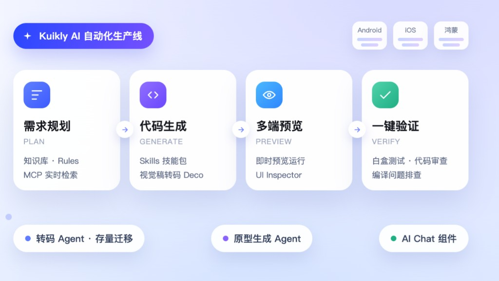
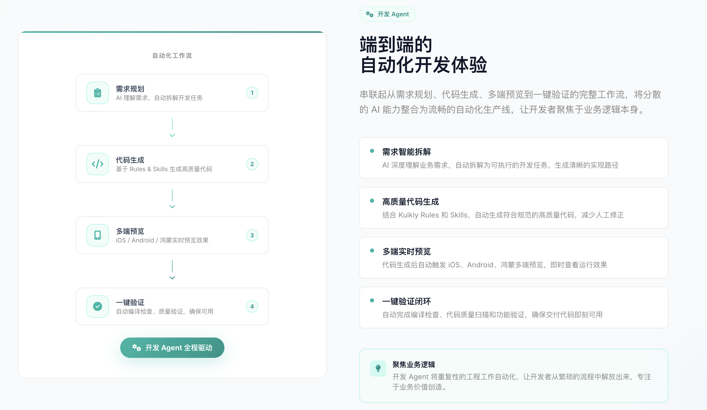

# Kuikly AI 整体介绍



AI 驱动 Kuikly 开发全链路，让跨端开发更智能、更高效。

## AI 驱动全链路开发

当前已落地 Skills、视觉稿转码、预览与 Inspector、转码 Agent、原型生成 Agent、白盒测试与知识库等能力，串联起从需求规划、代码生成、多端预览到一键验证的完整工作流，将分散的 AI 能力整合为流畅的自动化生产线，让开发者聚焦于业务逻辑本身。

同一套流程覆盖 Android、iOS、鸿蒙。

```
需求规划 PLAN          代码生成 GENERATE         多端预览 PREVIEW          一键验证 VERIFY
知识库、Rules          Skills 技能包             即时预览运行              白盒测试、代码审查
MCP 实时检索     →     视觉稿转码 Deco     →     UI Inspector        →     编译问题排查
```

生产线之外，还可以按场景使用：

- **转码 Agent**：存量页面迁移
- **原型生成 Agent**：面向产品、设计师和其他非客户端开发角色，从一句话生成可在真机运行的原型和轻量 App
- **AI Chat 组件与 A2UI**：在业务 App 里接入对话界面，并渲染 Agent 下发的可交互界面

下面按能力逐项介绍。知识库、Kuikly Rules、Kuikly Skills、转码 Agent、AI Chat 组件已发布，其余能力随 Kuikly AI 逐步开放。

---

## 知识库

**已发布** · 知识库集成

汇集 Kuikly 官方文档与常见问题，为 AI 提供可靠的框架知识。整理文档和常见问题解答之后，模型在生成代码、回答用法时有稳定依据，而不是只靠训练语料里对 Kuikly 的零散印象。

---

## Kuikly Rules

**已发布** · DSL 规范 · API 规范 · 最佳实践

将 DSL 规范、组件 API 和开发实践写入规则，帮助 AI 生成更符合项目要求的代码。Rules 用来弥补大模型对 Kuikly 规范的理解缺失，内容覆盖源码结构、组件 API、DSL 规范和最佳实践。

Rules（规则文件）定义 AI 编程助手的行为准则和开发规范。引入之后，AI 工具能按项目的技术标准和协作流程写代码。

Kuikly 有两套 DSL，缺规则时都容易写错：

- **Kuikly DSL** 是一套专用 DSL，训练语料覆盖有限，没有规则约束时容易生成不可用代码。
- **Kuikly Compose DSL** 遵循 Compose 写法，但包名、组件 API 和参数与 Jetpack Compose 并不完全相同，模型容易误用官方 `androidx.compose.*`。

因此两套 DSL 各自有一份规则：

| 规则 | 适用 |
| :--- | :--- |
| `kuiklyDSL.mdc` | Kuikly DSL |
| `kuiklyComposeDSL.mdc` | Kuikly Compose DSL |

规则以 `.mdc`（Markdown + YAML front-matter）编写。CodeBuddy 会把它当作项目上下文自动加载；Cursor 放在 `.cursor/rules/` 即可。也可以按团队目录结构、命名和架构约定自行扩展，让模型同时遵守框架规范和工程规范。

仓库与安装方式见 [Kuikly AI 基础工具](./kuikly-ai.md)，地址：[KuiklyUI-AI](https://github.com/Tencent-TDS/KuiklyUI-AI)。

---

## Kuikly Skills

**已发布** · 组件助手 · 编译排查 · 代码审查

针对组件开发、编译排查和代码审查等任务，提供可按需调用的开发指南。Skills 是面向特定场景的技能包，让 AI 按规范完成对应任务，覆盖框架集成、UI 构建、基础开发能力和原生扩展。

- **按场景给方案**：组件用法、编译失败、代码审查各自有明确步骤，而不是一段笼统提示词。
- **按对话自动启用**：根据当前任务识别并加载对应技能，不用手动切换。
- **可以组合**：复杂需求可以同时用到多个技能，例如先按组件规范搭页面，再按扩展规范补一个原生 Module。

安装与技能列表见 [Kuikly AI 基础工具](./kuikly-ai.md)。

---

## Kuikly MCP

组件查询 · 文档检索 · 代码质量

让 AI 按需查询官方文档、组件信息和开发工具，获取与当前任务相关的知识。Kuikly MCP 基于 Model Context Protocol，把文档、组件库索引和开发工具接到编程助手上，查询发生在任务进行时，避免把整份文档塞进上下文，也避免沿用过期记忆。

---

## 视觉稿转码

Figma 转码 · 高还原度 · 资源同步

通过 Deco 将 Figma 设计稿转换为 Kuikly 页面代码，保留布局与样式信息。设计稿到代码的重复劳动（对边距、量字号、手动切图）交给转码完成，开发者继续处理业务逻辑。

- **少写重复 UI**：一键转出页面代码，把时间留给交互和业务。
- **按设计稿还原**：保留布局、样式和视觉层级，减少设计和开发之间的返工。
- **资源一并处理**：提取图片资源并同步，支持 Android Studio 插件和 CLI，不用逐张导出再改引用。
- **转码前后一起做**：转码前做设计稿检查，团队内共享组件和规范；设计改稿后增量更新；交付前做设计走查。

---

## 预览 & Inspector

即时预览 · 组件树 · 属性检查

即时查看页面效果，并通过 UI Inspector 检查组件树和属性。AI 写出界面之后，可以马上看运行结果，再用可视化方式查布局问题。

预览基于 Compose 预览能力增强：代码生成或修改后由 IDE 做增量编译并刷新预览，不必先打完整 APK、再装到设备上才能看效果。UI Inspector 配合组件树和属性面板，用来定位具体节点。

- **增量预览**：改完即看，用来确认生成的 UI 是否符合预期。
- **组件树**：展示层级，直接定位目标组件。
- **属性检查**：查看布局、样式、尺寸，并高亮边界和间距。
- **多状态预览**：切换设备、主题和状态，让预览更接近最终运行效果。

---

## 转码 Agent

**已发布** · React · Vue · Hippy · AI 转换

辅助将 React、Vue、Hippy 等存量页面迁移为 Kuikly 代码，减少重复改写。Agent 分析源码里的组件关系和页面结构，完成框架语法和 API 映射。

- **多框架**：覆盖 React、Vue、Hippy，以及安卓原生界面、iOS 原生界面和 HTML 页面。
- **转换有效率 80%+**：处理组件映射、样式转换和生命周期适配，先得到可编译、可对照的页面骨架。
- **重构耗时从 3 天到 1 天**：基础迁移交给 Agent，人工重点放在复杂交互和验收。

迁移流水线、主从 Skill 以及 Vue / React 测评见 [其他框架转码 Kuikly](./transcode.md)。工具仓库：[React2Kuikly](https://github.com/Tencent-TDS/React2Kuikly)、[Vue2Kuikly](https://github.com/Tencent-TDS/Vue2Kuikly)。

---

## AI Chat 组件与 A2UI

**已发布** · 一键接入 · 多模型支持 · 跨端一致 · 高度可定制

对话界面和 Agent 动态界面放在一起用。AI Chat 组件负责会话本身：消息列表、流式输出、输入栏和样式。A2UI 负责对话里的可交互界面：Agent 不下发可执行代码，只下发声明式界面描述，由 Kuikly 用原生组件渲染。

### AI Chat 组件

快速接入对话界面，按业务需要配置模型与样式，保持多端体验一致。官方组件把气泡列表、流式状态和输入栏封装好，业务侧完成配置即可在 App 内提供对话能力。

- **开箱即用**：组件和会话流程已封装，接入时配置模型和页面参数。
- **多模型**：按场景选择模型，不把对话 UI 和某一个模型绑死。
- **跨端一致**：同一套组件跑在 Android、iOS、鸿蒙上。
- **样式可配**：气泡、字体、输入框可以按业务品牌调整。

会话组件、Markdown 渲染，以及 DeepSeek Harness 移动端示例见 [Kuikly AIChat 套件](./chat-markdown.md)。

### A2UI

[A2UI 协议](https://a2ui.org/) 让服务端大模型生成结构化 JSON，动态描述 UI 卡片，客户端再按 JSON 里的 UI 树渲染界面，用来替换对话里的静态文本。

Kuikly A2UI 用 Kuikly 的渲染能力，在 Android、iOS、HarmonyOS 上原生渲染这套协议，并扩展了样式和自定义组件。SDK 把 JSON 流渲染成卡片，用户操作卡片后通过 Action 回调给业务：可以本地处理，也可以交回服务端智能体，再生成新的 JSON 流。内部路径是：协议 → 内部消息 → DSL 操作 → 原生视图。

完整介绍、接入方式和 Demo 见 [Kuikly A2UI](./a2ui.md)。

---

## 开发 Agent

需求规划 · 代码生成 · 多端预览 · 一键验证

串联需求拆解、代码生成、预览和验证，形成完整的辅助开发流程。它把上面的知识库、Rules、Skills、视觉稿转码、预览和检查串成一条线。



1. **需求规划**：理解业务需求，拆成可执行任务和实现路径。这一步也会用到知识库、Rules 和 MCP 检索。
2. **代码生成**：按 Rules 和 Skills 生成符合 Kuikly 规范的代码；有设计稿时走视觉稿转码。
3. **多端预览**：生成后在 Android、iOS、鸿蒙上查看运行效果，并用 Inspector 检查组件。
4. **一键验证**：做编译检查、代码审查和白盒测试，确认交付物可以接着开发，而不是停在一份还编不过的草稿。

产品、设计师和其他非客户端开发角色如果要从一句话做出可运行原型，走 [原型生成 Agent](./workshop-agent.md)。开发侧的重复工程步骤留在这条流程里，业务规则和交互取舍仍由人决定。

原理、组件复用和接入方式见 [D2C 设计稿转代码](./d2c.md)。体验与接入请联系 **Kuikly 小助手** 微信。


