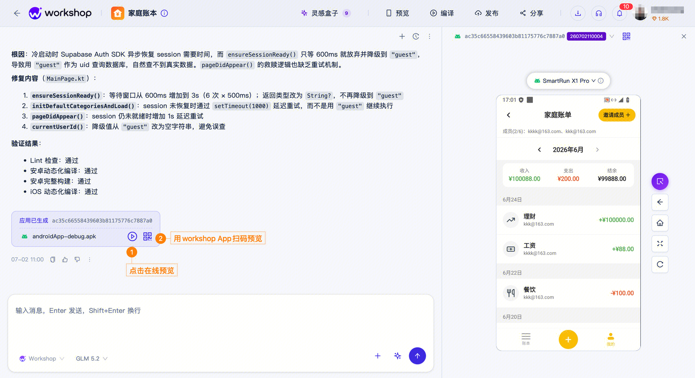

# 原型生成 Agent

原型生成 Agent 是基于 Kuikly 的从 0 到 1 创意生成工具，面向产品、设计师和其他非客户端开发角色。用自然语言描述想法，就能得到一个可以在真机上运行的 App，覆盖 iOS 和 Android。

它复用 Kuikly 的开发生产线：需求规划、代码生成、多端预览、在线 Inspector 调试、一键验证。业务侧拿到的是原型创建和轻量页面生成，不必先组一支客户端团队。

目前 Agent 平台已发布上架 **140** 个 App，共 **100** 人参与创作。

## 适合做什么

| 场景 | 说明 |
| :--- | :--- |
| 团队共享 | 团队有 App 需求，但没有客户端开发 |
| 产品验证 | 快速搭建 App demo 框架，验证想法后交给开发直接迭代 |
| 创意表达 | 把一个想法做成可以给别人用的 App |
| 个性专属 | 为自己或家人做的小工具 |

创作在 Web 或 Mac 上完成。体验和交付是 iOS、Android 原生 App。

## 从一句话到可体验的 App

1. **需求规划**：在工作台输入想法，描述要做什么、给谁用、核心页面有哪些，然后发送。
2. **代码生成**：按 Kuikly / Compose DSL 生成页面和交互，在后台沙盒里编译。对话区会给出修改说明和编译结果。
3. **多端预览**：右侧是 smartrun 云真机，可以直接看页面。也可以点在线预览，或用 Workshop App 扫码，在真机上体验，不必先发布。
4. **在线 Inspector 调试**：在线查看页面组件树和属性，定位布局与样式问题，并结合预览效果持续调整。
5. **一键验证**：效果满意后发布到应用社区。其他人用 Workshop App 扫码即可体验和反馈。

发布时填写应用名称、描述、封面和图标、分类标签，并选择 Android、iOS 或两端一起发布。版本号自动取最新版本。发布后可以改名称、描述、封面和分类，不必为此重新发一版。下架后数据还在，可以再上架；删除则会清掉该 App 的数据。

## 近期能力

1. **组件与编译体验**  
   支持 Compose DSL 和 Kuikly 的 20+ 组件。编译在后台沙盒完成。预览提供 smartrun 云真机，也支持真机 App 动态下发。

2. **生成与调试**  
   支持模型智能路由、subagent、Inspector 调试，以及原生多模态输入。

3. **HTML 转 App**  
   已有 HTML 页面可以直接转成可运行的 App，作为原型或轻量工具的起点。

体验与接入请联系 **Kuikly 小助手** 微信。

