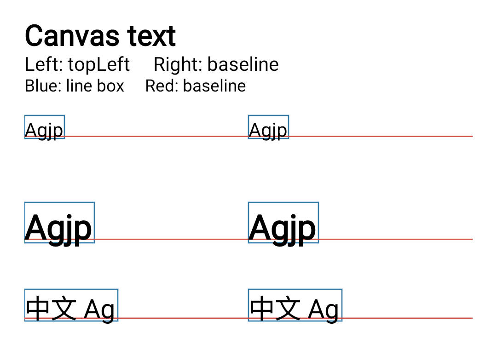
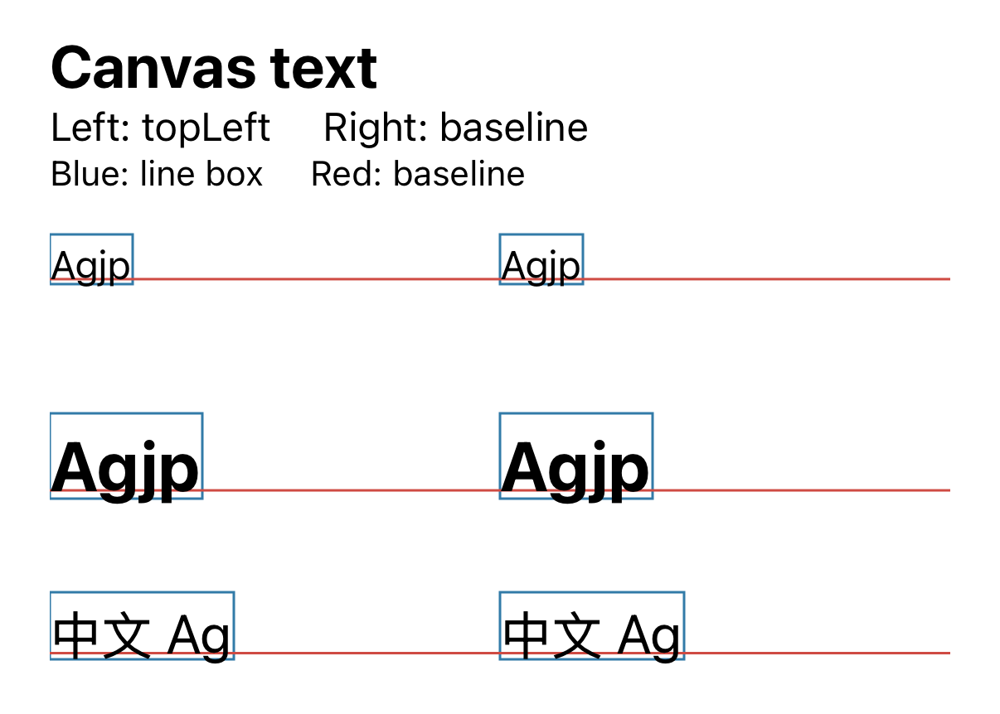
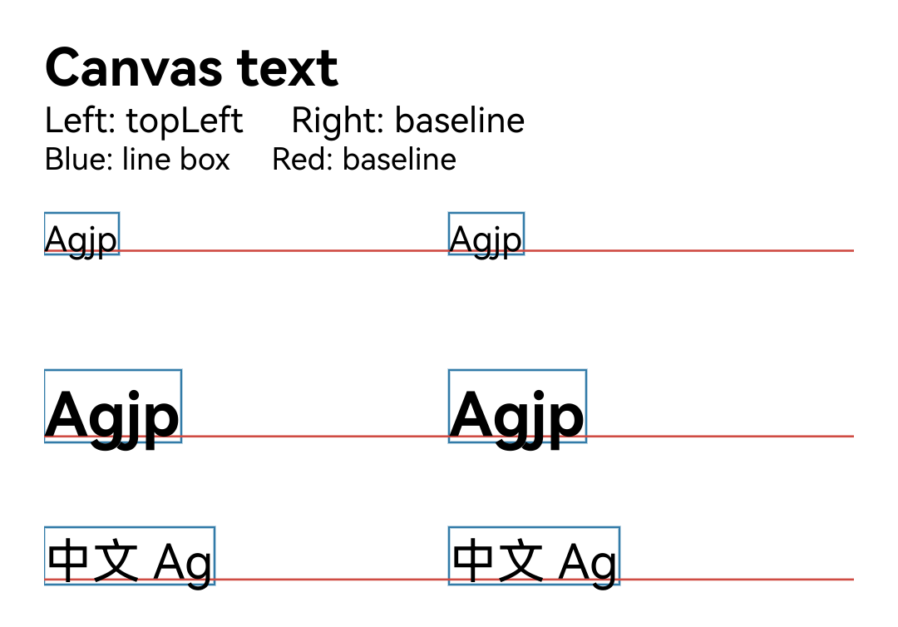
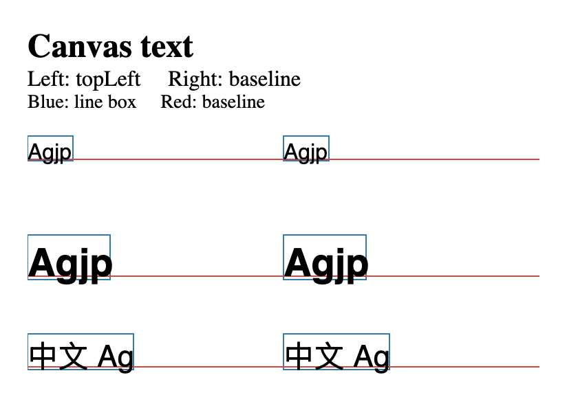

# Canvas 与自定义绘制

Kuikly Compose 支持通过 `Canvas` 组件与绘制类 Modifier 进行自定义绘制，绘制逻辑运行在 **DrawScope** 作用域内。

## Canvas 组件

在指定区域内执行画布绘制。

| 参数 | 描述 | 类型 |
| -- | -- | -- |
| modifier <Badge text="必需" type="warn"/> | 尺寸策略，**必须指定尺寸** | Modifier |
| contentDescription <Badge text="非必需" type="warn"/> | 无障碍服务使用的描述文本（仅在带该参数的重载中提供，且为必填） | String |
| onDraw <Badge text="必需" type="warn"/> | 绘制逻辑 | DrawScope.() -> Unit |

:::: warning 使用限制
- `modifier` 必须指定尺寸（`Modifier.size()`、`Modifier.fillMaxSize()`、`ColumnScope.weight()` 等）；父容器为包裹内容时只能使用精确尺寸。
- `onDraw` 在**绘制阶段**执行，其中不能调用 `@Composable` 函数，否则会在运行时抛异常。
::::

**示例**

```kotlin
Canvas(modifier = Modifier.size(200.dp)) {
    drawRect(color = Color.Red)
    drawLine(
        color = Color.Blue,
        start = Offset(0f, 0f),
        end = Offset(size.width, size.height),
        strokeWidth = 4f
    )
}
```

## Canvas 文本绘制

`drawText` 的 `topLeft` 是单行文本框的左上角，坐标单位为 px。传 `Offset.Zero` 即从画布左上角绘制。需要以字母基线定位坐标轴刻度时，使用实验接口 `drawTextAtBaseline` 并标注 `@OptIn(ExperimentalTextApi::class)`。

从 Compose Multiplatform 迁移单行标签时，保留下面的调用方式，把 `androidx.compose.ui.text` 下的 `drawText`、`rememberTextMeasurer` 和 `TextStyle` 换为 `com.tencent.kuikly.compose.ui.text` 下的同名导入。

```kotlin
@Composable
fun ChartLabels(labels: List<String>, style: TextStyle) {
    val tm = rememberTextMeasurer()
    val layouts = remember(tm, labels, style) { labels.map { tm.measure(it, style) } }
    Canvas(Modifier.fillMaxWidth().height(48.dp)) {
        layouts.forEachIndexed { i, layout ->
            val centerX = (i + 0.5f) * size.width / layouts.size
            drawText(layout, topLeft = Offset(centerX - layout.size.width / 2f, 0f))
        }
    }
}
```

`measure` 可在第一次绘制前调用。缓存未命中时，它同步创建原生文本 shadow、测量并释放。上例在标签或样式变化时测量，动画每帧只更新位置。少量标签也可直接调用 `drawText(tm, label, topLeft = position, style = style)`。同一个 measurer 默认保留最近使用的 8 个 `(text, style)` 结果，可通过 `rememberTextMeasurer(cacheSize = …)` 调整。

避免把整批标签的测量放进逐帧绘制回调。如果标签多于缓存容量，下面的循环会反复触发同步测量：

```kotlin
Canvas(Modifier.fillMaxSize()) {
    labels.forEachIndexed { i, label ->
        val layout = tm.measure(label, style)
        drawText(layout, topLeft = Offset(i * 40.dp.toPx(), 0f))
    }
}
```

| 与 CMP 的差异 | Kuikly 的行为 |
| --- | --- |
| 文本和换行 | 仅支持单行 `String`。含 `\n` 或 `\r` 的输入会抛出异常，请先拆行并分别定位。 |
| 测量结果 | `CanvasTextLayoutResult.size` 给出包住该行的整数像素尺寸。`firstBaseline` 是按字号与行高估算的基线距离，系统字体和后备字体会影响实际字形边界。 |
| 样式 | 支持 color、fontSize、fontFamily、fontStyle、fontWeight、textAlign。字重与 Text 组件使用相同分档，例如 W100 为 300，W800/W900 为 700。 |
| 字号 | 默认 15dp，显式 sp 按 Compose 的 density 换算，不再乘 Compose 的 fontScale。OHOS 原生渲染仍使用宿主配置的字号比例。 |
| 对齐 | 顶点定位使用紧包单行的文本框。基线接口的 Center、End/Right 可指定水平锚点，Start/End 按从左到右解释。 |
| 排版与绘制 | 不支持 RTL 段落布局、overflow、maxLines、brush 或 blendMode。描边支持 width 和 cap。 |

示例页 `CanvasTextDemo` 左侧按文本框左上角绘制，右侧直接按基线绘制。蓝框标出测量的行框，红线标出指定的基线。下图从各端运行同一示例页的画面截取，保留原始像素。

| Android | iOS |
| --- | --- |
|  |  |

| HarmonyOS | H5 |
| --- | --- |
|  |  |

## 绘制 Modifier

:::: warning 生效范围
`Modifier.drawBehind` 仅在 `Canvas` 组件上生效。
::::

### Modifier.drawBehind

在组件内容**背后**绘制。

| 参数 | 描述 | 类型 |
| -- | -- | -- |
| onDraw | 绘制逻辑 | DrawScope.() -> Unit |

## DrawScope

绘制作用域，提供当前绘制环境信息与绘制方法。

**环境信息**

| 属性 | 描述 | 类型 |
| -- | -- | -- |
| `size` | 当前绘制区域尺寸 | Size |
| `center` | 当前绘制区域中心点 | Offset |
| `layoutDirection` | 布局方向 | LayoutDirection |
| `drawContext` | 绘制上下文 | DrawContext |

**变换与裁剪**

| 方法 | 说明 |
| -- | -- |
| `inset` | 收缩绘制区域 |
| `translate` | 平移 |
| `rotate` / `rotateRad` | 旋转（角度 / 弧度） |
| `scale` | 缩放 |
| `clipRect` / `clipPath` | 按矩形 / 路径裁剪 |
| `withTransform` | 组合多个变换 |
| `drawIntoCanvas` | 直接操作底层 `Canvas` |

**绘制方法**

| 方法 | 说明 |
| -- | -- |
| `drawLine` | 绘制线段（支持 `Color` 与 `Brush` 两个重载） |
| `drawRect` | 绘制矩形（支持 `Color` 与 `Brush` 两个重载） |
| `drawRoundRect` | 绘制圆角矩形 |
| `drawCircle` | 绘制圆 |
| `drawOval` | 绘制椭圆 |
| `drawArc` | 绘制圆弧 |
| `drawPath` | 按 `Path` 绘制 |
| `drawPoints` | 绘制点集 |
| `drawOutline` | 按 `Outline` 绘制 |
| `drawText` | 按文本框左上角绘制单行文本 |

:::: warning 与标准 Compose 的差异
- `pathEffect` 仅支持 `PathEffect.dashPathEffect(intervals, phase)`，`cornerPathEffect`、`chainPathEffect`、`stampedPathEffect` 无对应实现。
- `phase` 传入后被忽略，不报错。CMP 中常见的"蚂蚁线"写法在 Kuikly 上编译通过，但虚线静止，也没有等价的替代写法：

```kotlin
// CMP 里常见的蚂蚁线写法，在 Kuikly 上 phase 不生效，虚线不会动
val phase by rememberInfiniteTransition().animateFloat(
    initialValue = 0f,
    targetValue = 20f,
    animationSpec = infiniteRepeatable(tween(500, easing = LinearEasing))
)
Canvas(Modifier.fillMaxWidth().height(2.dp)) {
    drawLine(
        color = Color.Gray,
        start = Offset.Zero,
        end = Offset(size.width, 0f),
        strokeWidth = 2.dp.toPx(),
        pathEffect = PathEffect.dashPathEffect(floatArrayOf(12f, 8f), phase)
    )
}
```

- `intervals` 必须是偶数个（≥ 2）非负数，且不全为 0，否则抛 `IllegalArgumentException`。
- `colorFilter`、`blendMode` 仍未开放，依赖它们的绘制逻辑需改用其他方式实现。
::::
